<div align="center">

<picture>
  <source media="(prefers-color-scheme: dark)" srcset="docs/brand/clinicit-logo-dark.svg" />
  
</picture>

### Run the clinic day without a reception desk.

**Self check-in and live queues for outpatient clinics.**
Patients scan a QR code, check themselves in on their own phone and are matched to a doctor who is ready. Their phone shows their place, an estimated wait and, when called, which room to go to.

[**Live app**](https://clinicit.vercel.app) · [Try the demo clinic](#try-it-locally) · [Architecture](docs/ARCHITECTURE.md) · [Self check-in](docs/SELF_CHECK_IN.md) · [API](docs/API.md) · [Security](docs/SECURITY.md)

[](https://github.com/Rrachet/ClinicIT/actions/workflows/ci.yml)


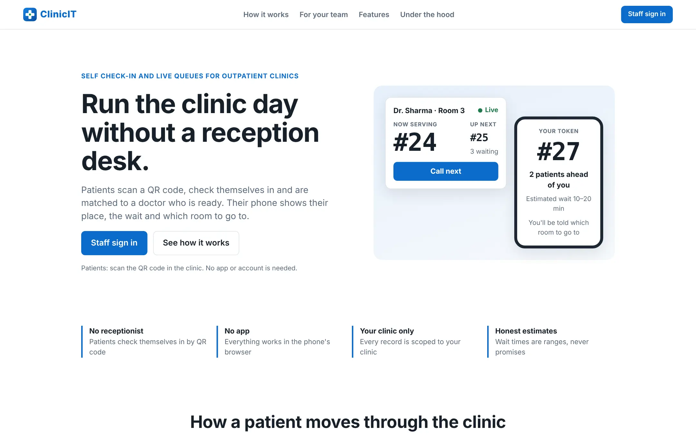

</div>

---

## Contents

- [Why ClinicIT](#why-clinicit)
- [How it works](#how-it-works)
- [Product tour](#product-tour)
- [Features](#features)
- [Architecture](#architecture)
- [Tech stack](#tech-stack)
- [Security and responsible use](#security-and-responsible-use)
- [Quality and testing](#quality-and-testing)
- [Try it locally](#try-it-locally)
- [Project structure](#project-structure)
- [Deployment](#deployment)
- [Roadmap](#roadmap)

## Why ClinicIT

In a busy outpatient clinic, the front desk is the bottleneck. Patients queue to say their name, reception phones round
to find which doctor is free, and everyone in the waiting room keeps asking "how long?".

ClinicIT removes that desk from the critical path:

| For patients | For doctors | For the clinic |
| --- | --- | --- |
| Scan a QR code, type a name and number, pick a visit: done | "Go live" when ready, "Go offline" when done | No receptionist needed to run the day |
| Their place, how many are ahead and a wait range, live | The current patient, their note and who is next | Every queue on one screen, with manual control when needed |
| "It's your turn, go to Room 3", with sound and vibration | One click each: call next, start, complete | Waits, no-shows, workload and trends from recorded history |
| No app, no account, works in any phone browser | Only their own queue, always current | Clinic data isolated by design, at every layer |

## How it works

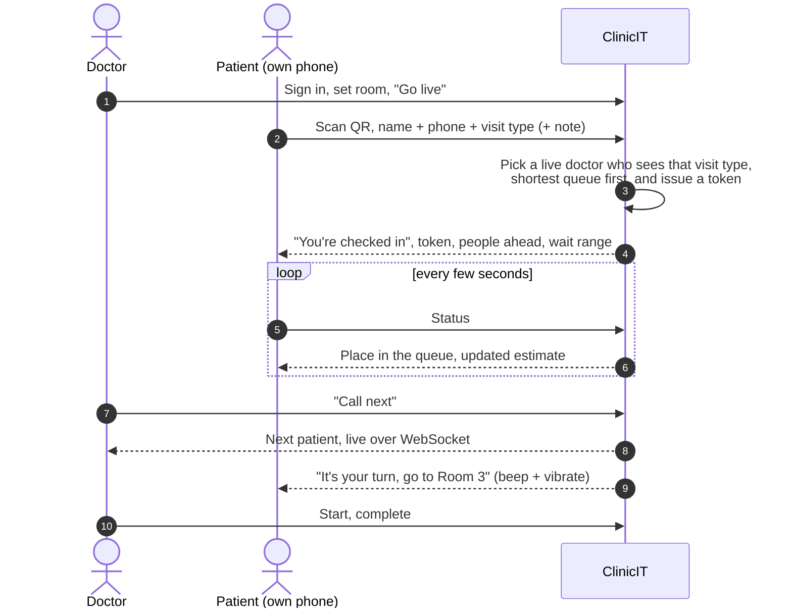

- **The patient's choice decides the doctor.** The visit type ("Child (under 16)", "Skin and hair", "General
  check-up") maps to the doctors who see it; among those who are live, ClinicIT takes the shortest queue. What the
  patient writes is only shown to the doctor. Nothing about their health is inferred.
- **One place per patient per day.** Scanning again returns the same token, never a second one.
- **Live is per day.** A doctor who forgets to go offline is not live tomorrow; the admin can also take them offline.
- **Or just chat.** With the AI receptionist on, the QR code opens a chat instead: "my son has a fever, can we come
  tomorrow evening?" gets real free slots and a booking. Bookings show up on the doctor's list; on arrival the patient
  scans again and joins the queue ([AI_RECEPTIONIST.md](docs/AI_RECEPTIONIST.md)).
- **A front desk is optional.** Reception tools stay available to book ahead, add patients without a phone, and fix
  anything by hand.

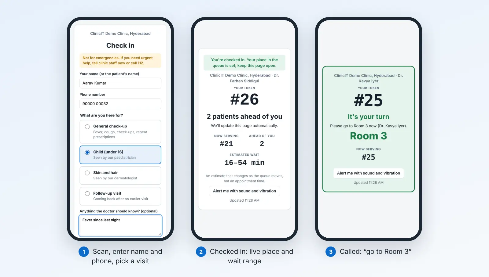

## Product tour

<table>
  <tr>
    <td width="50%">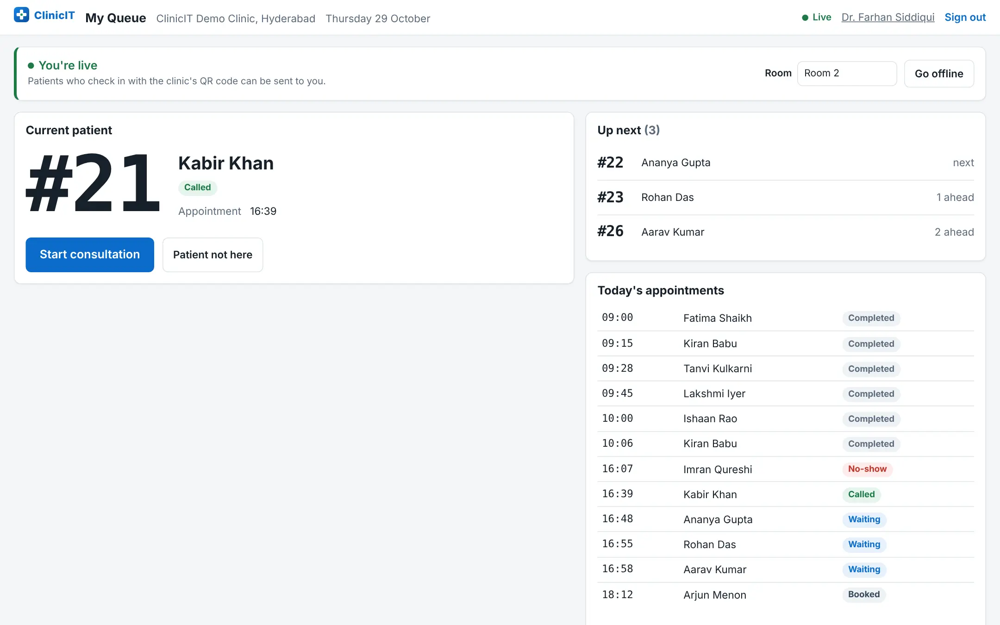<br/><sub><b>Doctor's screen.</b> Live status and room, the current patient with their note, who is next, and today's list.</sub></td>
    <td width="50%">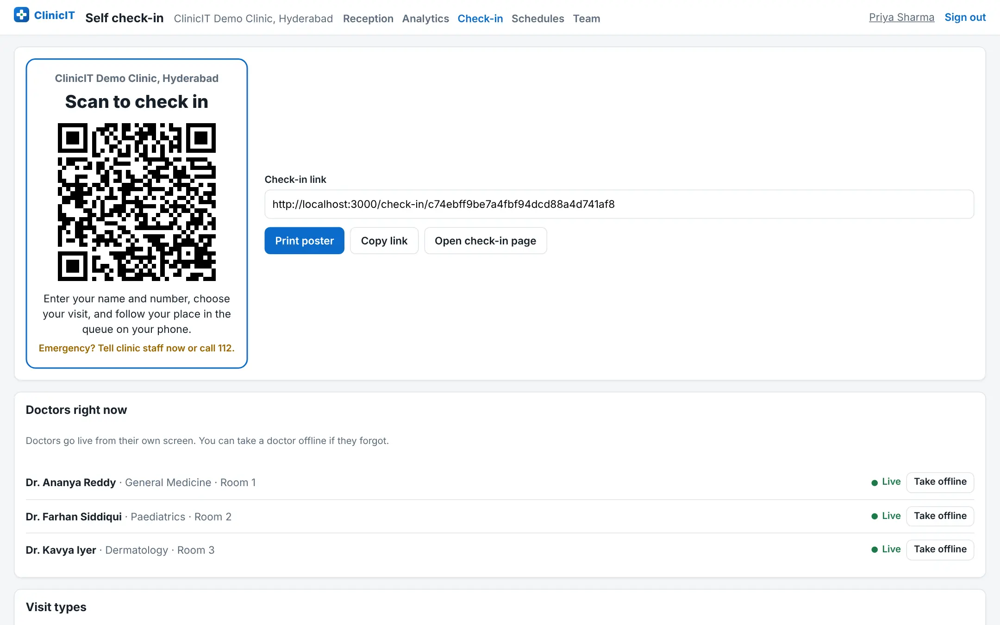<br/><sub><b>Self check-in setup.</b> Printable QR poster, visit types and which doctors see each, who is live right now.</sub></td>
  </tr>
  <tr>
    <td>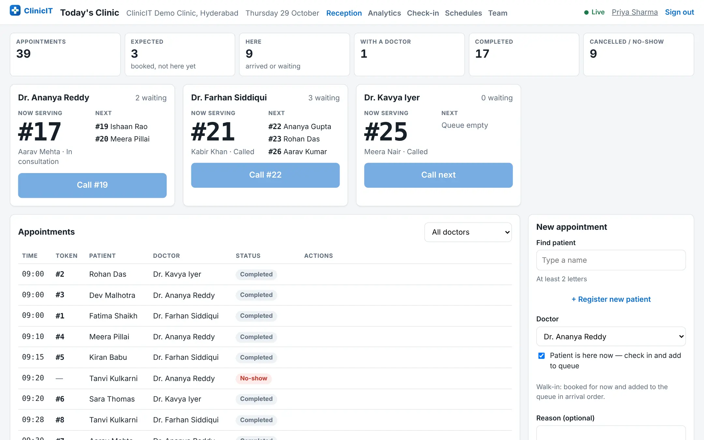<br/><sub><b>Every queue at once.</b> Today's counts, each doctor's queue live, and manual actions: call, skip, requeue, no-show.</sub></td>
    <td>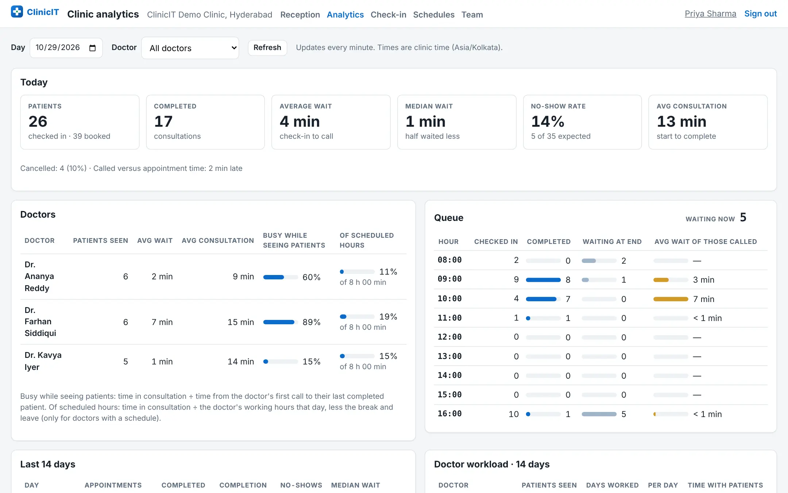<br/><sub><b>Clinic figures.</b> Average and median wait, completions, no-show rate, hourly queue, doctor workload and 14-day trends.</sub></td>
  </tr>
  <tr>
    <td>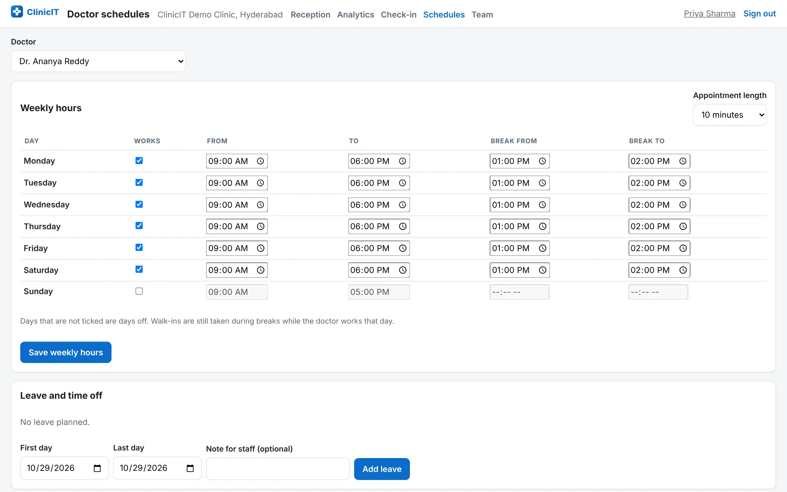<br/><sub><b>Schedules.</b> Weekly hours, lunch breaks, appointment length and leave; bookings respect them.</sub></td>
    <td>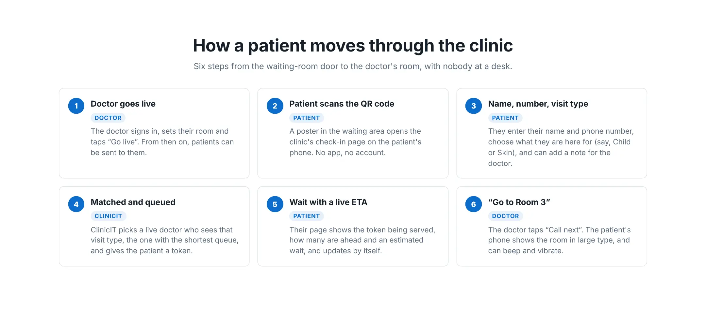<br/><sub><b>Public home page.</b> How a patient moves through the clinic, for staff and patients alike.</sub></td>
  </tr>
</table>

All screenshots show the fictional [demo clinic](docs/DEMO.md).

## Features

### Patients
- **AI receptionist chat** on the QR code: patients write in their own words and language, and Claude checks them in
  or books a free slot, only through ClinicIT's own rules ([AI_RECEPTIONIST.md](docs/AI_RECEPTIONIST.md))
- **QR self check-in form** from their own phone: name, phone, visit type and an optional note for the doctor
- A clear **"Not for emergencies"** notice on the check-in page
- A live status page: token, token being served, people ahead and an **approximate wait range**
- **"It's your turn, go to Room 3"** in large type, with optional sound and vibration
- No app, no account, no staff data on any public page

### Doctors
- **Go live / go offline** and set their room; self check-in only sends patients to live doctors
- The current patient with the reason for the visit, who is next, and the day's appointments
- Call next, start, complete, skip; only their own queue, updated in real time

### Clinic admins
- **Check-in setup:** printable QR poster, visit types and the doctors who see each, live doctors
- Every doctor's queue on one live screen, with call, skip, requeue, no-show, cancel and reschedule
- Doctors, staff logins and roles; weekly hours, breaks, appointment length and leave
- **Analytics** from an immutable history: waits, completions, no-shows, hourly load, workload, utilization, trends
- Advisory **no-show risk** flag for booked appointments, with its evaluation on the clinic's own history

### Platform
- **Real-time** over STOMP/WebSocket for staff; polling for patients, so public pages never touch the staff channel
- **Wait estimates** from an optional ML service, with a deterministic fallback; always a range, never a promise
- Patient messages through an **outbox** (at-least-once, idempotent), ready for an SMS or WhatsApp provider
- Responsive from 360px phones to large desktops, keyboard and screen-reader friendly

## Architecture

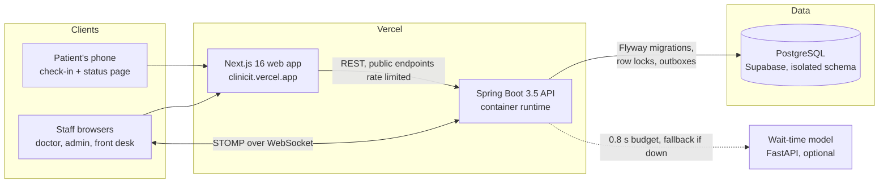

A **modular monolith** in Java 21: `identity`, `clinic`, `patient`, `appointment`, `checkin`, `receptionist`, `queue`, `schedule`,
`realtime`, `notification`, `history`, `analytics`, `prediction`, `noshow`. PostgreSQL is the only store: no Redis,
no message broker, no microservices.

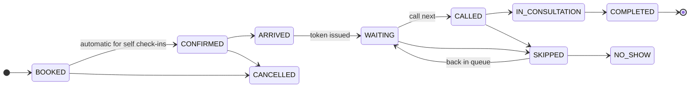

The decisions that carry most of the weight:

- **Tokens and concurrency.** A token is unique per clinic per day, allocated by an atomic counter upsert, never
  `MAX + 1`. "Call next" locks the doctor row; a partial unique index allows one active patient per doctor; bookings
  and self check-ins take the same lock. Concurrency tests against real PostgreSQL prove it
  ([QUEUE_ENGINE.md](docs/QUEUE_ENGINE.md)).
- **Clinic isolation everywhere.** Every query starts from the caller's clinic, and composite foreign keys make the
  database itself reject cross-clinic references ([SECURITY.md](docs/SECURITY.md)).
- **An immutable history** (append-only, enforced by a trigger) feeds analytics, wait-estimate features and the
  no-show evaluation, using only what was known at the time.
- **Outboxes** for live updates and patient messages; a relay delivers live updates across instances when the
  serverless runtime scales out ([REALTIME.md](docs/REALTIME.md)).
- **Time.** Schedules are clinic wall-clock time, events are instants; the server's zone is never used, and tests run
  in another zone to prove it.

More in [docs/ARCHITECTURE.md](docs/ARCHITECTURE.md) and [docs/DATA_MODEL.md](docs/DATA_MODEL.md).

## Tech stack

| Layer | Choice |
| --- | --- |
| API | Java 21, Spring Boot 3.5 (Web, Security, Data JPA, JDBC, WebSocket/STOMP, Actuator, Micrometer), Flyway |
| Database | PostgreSQL 16+, 14 versioned migrations, row locks, partial unique indexes, append-only history |
| Web app | Next.js 16 (App Router), React 19, TypeScript strict, a small hand-written design system, QR codes in the browser |
| AI receptionist | Claude (Anthropic Java SDK, Messages API with strict client tools, prompt caching, server-side fallbacks) |
| ML | Python 3.11, FastAPI, scikit-learn; a versioned JSON contract with the API |
| Hosting | Vercel (web app and API container), Supabase PostgreSQL; Docker images for every service |
| Testing | JUnit 5 against real PostgreSQL, Vitest + Testing Library, pytest, Playwright end to end |
| CI | GitHub Actions on every pull request: backend, ML, frontend, browser E2E on the real stack, Docker Compose smoke |

## Security and responsible use

- Server-side sessions with roles (admin, doctor, front desk); every endpoint declares its roles, and a test fails if
  one does not
- Clinic isolation in every query and in the schema itself
- Public pages (check-in, patient status) are rate limited per address and return no staff or patient details;
  status links are unguessable and expire with the day
- The API refuses to start in production with unsafe settings: development passwords, wildcard or plain-HTTP CORS,
  demo data, the development message provider
- Strict Content-Security-Policy, no secrets in the browser bundle, nothing sensitive in logs

ClinicIT is an **operational** system, not a clinical one. It never diagnoses, prescribes, reorders patients by
condition or refuses care. The doctor is chosen from the visit type the patient picks, never from what they write.
The AI receptionist books and checks in only through ClinicIT's own tools and rules, never gives medical advice, and
sends anything that sounds urgent straight to clinic staff or 112.
Wait estimates and the no-show flag are advisory and labelled that way ([AI.md](docs/AI.md),
[NO_SHOW_RISK.md](docs/NO_SHOW_RISK.md)).

## Quality and testing

| Check | What it covers | Command |
| --- | --- | --- |
| Backend | 300 JUnit tests against real PostgreSQL: queue concurrency, scheduling rules, self check-in matching, clinic isolation, security coverage of every endpoint, migrations | `mvn verify` |
| Web app | 139 Vitest + Testing Library tests, strict typecheck, ESLint, production build | `npm test && npm run typecheck && npm run lint && npm run build` |
| ML service | 38 pytest tests: API contract, baseline, dataset, leakage checks, training | `python -m pytest` |
| End to end | Playwright on the real stack: self check-in to "go to Room 3", the full visit, walk-ins, skips and no-shows, roles, scheduling, analytics, wait estimates | `scripts/e2e.sh` |
| Docker | The Compose stack starts and answers | `scripts/ci/compose-smoke.sh` |

What each suite proves: [docs/TESTING.md](docs/TESTING.md). An honest assessment of the limits:
[docs/REVIEW.md](docs/REVIEW.md).

## Try it locally

```bash
git clone https://github.com/Rrachet/ClinicIT.git
cd ClinicIT
docker compose up --build        # then open http://localhost:3000
```

The first start loads **ClinicIT Demo Clinic, Hyderabad**: three doctors, 18 fictional patients, two weeks of
history and today's queue with patients in every state.

| Sign in as | Email | Password |
| --- | --- | --- |
| Admin | `admin@demo.clinicit.local` | `local-demo-only-2026` |
| Doctor | `ananya.reddy@demo.clinicit.local`, `farhan.siddiqui@…`, `kavya.iyer@…` | same |
| Front desk | `reception@demo.clinicit.local` | same |

These are local demo credentials, published on purpose; production refuses demo data. To try self check-in, open
**Admin → Check-in**, add a visit type, go live as a doctor, then open the check-in link on your phone.

<details>
<summary><b>Without Docker</b></summary>

```bash
# API (needs PostgreSQL)
CLINICIT_CORS_ALLOWED_ORIGINS=http://localhost:3000 CLINICIT_DEMO_ENABLED=true \
CLINICIT_DEMO_PASSWORD=local-demo-only-2026 mvn spring-boot:run

# Web app
cd frontend && npm ci && NEXT_PUBLIC_API_BASE_URL=http://localhost:8080 npm run dev

# Wait-time model (optional): see ml/README.md
```

Tests: `CLINICIT_TEST_DB_URL=jdbc:postgresql://localhost:5432/clinicit_test mvn verify` (every table in that
database is truncated, so its name must contain "test").
</details>

## Project structure

```
src/main/java/com/clinicit/
  identity/        sessions, roles, staff accounts, security configuration
  clinic/          clinic, doctors, live status and rooms
  checkin/         QR self check-in, visit types, doctor matching
  receptionist/    the AI receptionist: Claude tool loop, booking tools, transcripts
  patient/         patients
  appointment/     appointments and their lifecycle
  queue/           the queue engine, tokens, public status
  schedule/        weekly hours, breaks, leave, booking rules
  realtime/        STOMP/WebSocket and the cross-instance relay
  notification/    patient messages through an outbox
  history/         the immutable event history
  analytics/       figures computed from the history
  prediction/      wait estimates (ML client and fallback)
  noshow/          the advisory no-show flag
  demo/            the demo clinic
src/main/resources/db/migration/   Flyway migrations V1 to V14
frontend/          Next.js web app: check-in, patient status, doctor, admin, home
  e2e/             Playwright tests against the real stack
ml/                wait-time model service (FastAPI, scikit-learn)
docs/              architecture, API, data model, security, operations, screenshots
scripts/           end-to-end runner and CI helpers
```

## Deployment

Live on free tiers: the web app at **[clinicit.vercel.app](https://clinicit.vercel.app)**, the API at
`clinicit-api.vercel.app` on Vercel's container runtime, and PostgreSQL on Supabase. Every merge to `main` deploys
both. [docs/DEPLOYMENT.md](docs/DEPLOYMENT.md) has the full runbook, including the alternative Koyeb + Neon setup;
[docs/OPERATIONS.md](docs/OPERATIONS.md) covers configuration, probes, metrics and logging.

## Roadmap

- SMS or WhatsApp messages to patients, behind the existing outbox (switched off until a provider is chosen)
- A kiosk mode for a tablet at the entrance, for patients without a phone
- Password reset by email and two-factor sign-in for admins
- Retraining the wait-time model on real clinic data (it is trained on a simulation today)
- Multi-clinic groups with shared reporting
